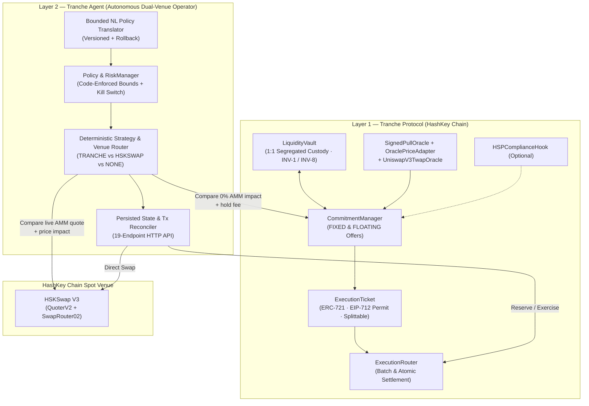

<p align="center">
  
</p>

<h1 align="center">TRANCHE</h1>

<p align="center">
  <strong>Programmable execution infrastructure for autonomous trading on HashKey Chain.</strong><br/>
  Separating decision time from settlement time via transferable ERC-721 Execution Tickets — powered by <strong>Tranche Protocol</strong> and <strong>Tranche Agent</strong>.
</p>

<p align="center">
  <a href="https://tranche.space"><strong>tranche.space</strong></a> &nbsp;·&nbsp;
  <a href="https://app.tranche.space"><strong>app.tranche.space</strong></a> &nbsp;·&nbsp;
  <a href="https://testnet-explorer.hskchain.net/tx/0x8f98a0f76772f0ec65b4da5c1621dbf22f15454433eac3902e212327e2d78e69"><strong>Chain 133 Proof Tx</strong></a>
</p>

<p align="center">
  
  
  
  
</p>

---

## The Problem

AMMs were built for humans clicking swap. On thin emerging-chain liquidity like HashKey Chain, passive AMM pools impose **13%–32% slippage on \$5k–\$10k orders** and **revert outright on \$50k trades** — breaking autonomous agents, treasury desks, and institutional execution.

**Tranche** solves this by separating **decision time** from **settlement time**:
1. **Layer 1 — Tranche Protocol:** LPs deposit ERC-20 inventory into a 1:1 segregated `LiquidityVault` and publish time-bounded execution commitments (`FIXED` strike or `FLOATING` TWAP-bounded oracle + spread). Traders and agents pay a small upfront hold fee to mint a transferable, splittable **ERC-721 `ExecutionTicket`** that guarantees `0.00%` AMM price impact up to the reserved capacity.
2. **Layer 2 — Tranche Agent:** An autonomous dual-venue trading operator that compares live **Tranche reserved inventory** against live **HSKSwap V3 `QuoterV2`** on every cycle, routing each trade to whichever venue delivers superior all-in execution (`TRANCHE` vs `HSKSWAP` vs `NONE`) under deterministic, code-enforced risk controls and an authoritative kill switch.

---

## Live HashKey Chain Mainnet (Chain 177) Slippage Benchmark

Measured live against **HashKey Chain Mainnet (`https://mainnet.hsk.xyz`, Block `30681941`, 2026-11-26 UTC)** via strictly read-only `HSKSwap V3 QuoterV2` (`0x603f70466fDdbE3F238220B9a74FFF419a2BbFDD`) simulations, compared against a Tranche fixed-strike reservation at a `0.50%` (`50 bps`) hold fee (`0.00%` AMM slippage, assuming matching LP vault inventory):

| Pair | Trade Size | Live Spot | HSKSwap V3 Cost | HSKSwap Impact + Fee | Tranche Cost (0.50% fee) | Savings via Tranche | Winner |
| --- | ---: | ---: | ---: | ---: | ---: | ---: | --- |
| **WHSK/USDT** | \$1,000 | \$0.08 | \$1,005.43 | 0.54% (`54 bps`) | \$1,005.00 | +\$0.43 | **TRANCHE** |
| **WHSK/USDT** | \$5,000 | \$0.08 | \$5,076.14 | 1.52% (`152 bps`) | \$5,025.00 | +\$51.14 | **TRANCHE** |
| **WHSK/USDT** | \$10,000 | \$0.08 | \$10,277.47 | 2.77% (`277 bps`) | \$10,050.00 | +\$227.47 | **TRANCHE** |
| **WHSK/USDT** | \$25,000 | \$0.08 | \$26,680.72 | 6.72% (`672 bps`) | \$25,125.00 | +\$1,555.72 | **TRANCHE** |
| **WHSK/USDT** | \$50,000 | \$0.08 | \$57,011.70 | 14.02% (`1402 bps`) | \$50,250.00 | +\$6,761.70 | **TRANCHE** |
| **WHSK/USDT** | \$100,000 | \$0.08 | \$132,095.84 | 32.09% (`3209 bps`) | \$100,500.00 | +\$31,595.84 | **TRANCHE** |
| **WETH/USDT** | \$1,000 | \$1,694.62 | \$1,027.65 | 2.76% (`276 bps`) | \$1,005.00 | +\$22.65 | **TRANCHE** |
| **WETH/USDT** | \$5,000 | \$1,694.62 | \$5,698.31 | 13.96% (`1396 bps`) | \$5,025.00 | +\$673.31 | **TRANCHE** |
| **WETH/USDT** | \$10,000 | \$1,694.62 | \$13,194.24 | 31.94% (`3194 bps`) | \$10,050.00 | +\$3,144.24 | **TRANCHE** |
| **WETH/USDT** | \$25,000 | \$1,694.62 | \$62,614.81 | 150.45% (`15045 bps`) | \$25,125.00 | +\$37,489.81 | **TRANCHE** |
| **WETH/USDT** | \$50,000 | \$1,694.62 | *Pool liquidity exhausted* | *Reverts* | \$50,250.00 | *Fills where AMM reverts* | **TRANCHE** |
| **WBTC/USDT** | \$1,000 | \$59,126.30 | \$1,026.15 | 2.61% (`261 bps`) | \$1,005.00 | +\$21.15 | **TRANCHE** |
| **WBTC/USDT** | \$5,000 | \$59,126.30 | \$5,652.50 | 13.05% (`1305 bps`) | \$5,025.00 | +\$627.50 | **TRANCHE** |
| **WBTC/USDT** | \$10,000 | \$59,126.30 | \$12,951.23 | 29.51% (`2951 bps`) | \$10,050.00 | +\$2,901.23 | **TRANCHE** |
| **WBTC/USDT** | \$25,000 | \$59,126.30 | \$57,495.22 | 129.98% (`12998 bps`) | \$25,125.00 | +\$32,370.22 | **TRANCHE** |
| **WBTC/USDT** | \$50,000 | \$59,126.30 | *Pool liquidity exhausted* | *Reverts* | \$50,250.00 | *Fills where AMM reverts* | **TRANCHE** |

Reproduce live in one command (strictly read-only, zero transactions broadcast):

```bash
cd agent && npm run bench:chain177
```

---

## Two-Layer Architecture



### Ticket Lifecycle

```text
1. Deposit      LP deposits ERC-20 (or segregates HSKSwap V3 LP NFT) into LiquidityVault
2. Offer        LP publishes a FIXED strike or FLOATING (oracle + spread) offer in CommitmentManager
3. Reserve      Trader or Agent pays upfront hold fee to mint a transferable ERC-721 ExecutionTicket
4. Compose      Ticket can be held, transferred, permitted (EIP-712), or split into child tickets
5. Exercise     Holder settles partially or fully at locked terms via CommitmentManager or ExecutionRouter
6. Reclaim      Expired capacity returns permissionlessly to the LP; LP withdraws proceeds anytime (INV-8)
```

---

## Live Deployments & Proof Artifacts

### 1. HashKey Chain Testnet (Chain 133) — **LIVE**
All 15 Tranche contracts and 3 Safe v1.4.1 multisig proxies (`3-of-5` Governance Safe, `2-of-3` Guardian Safe, `2-of-3` Treasury Safe) are deployed live on Chain 133 with `TimelockController` governance handover complete. Full manifest: [`deployments/hashkey-testnet.json`](deployments/hashkey-testnet.json).

| Contract | Chain 133 Address |
| --- | --- |
| `LiquidityVault` | `0xC2E5d68cd030677CB8f851b66ee370B304504cE1` |
| `CommitmentManager` | `0xBF79786d5B86D10616E31A40a867eA27bbbbFA3c` |
| `ExecutionTicket` (ERC-721) | `0x05d966961AE75505f15883ddD2715e1D7c1752c1` |
| `ExecutionRouter` | `0x471221ea2cAEFD3f17f5c55dE74B3e2876E14aAb` |
| `SignedPullOracle` | `0xADA5C8289Ca509723302Aad31B6EE5d13e013104` |
| `OraclePriceAdapter` | `0x83E27a6B5e038D75A5ee76195668c2ad09c37FCA` |
| `UniswapV3TwapOracle` | `0x62d35Afa9f975C1a6AA7Eeca17a16437A65Ff3a2` |
| `HSPComplianceHook` | `0x2cC9c9ccC91E14f911a8000C2Fbf0522aC612cD5` |
| `TimelockController` | `0x1bD32A02B02154c2e7Fb600FFc5D9116318FeE31` |

- **Live End-to-End Exercise Proof Tx:** [`0x8f98a0f76772f0ec65b4da5c1621dbf22f15454433eac3902e212327e2d78e69`](https://testnet-explorer.hskchain.net/tx/0x8f98a0f76772f0ec65b4da5c1621dbf22f15454433eac3902e212327e2d78e69)

### 2. HashKey Chain Mainnet (Chain 177) — **Fork-Verified, Ready for Launch**
- `contracts/test/MainnetFork.t.sol` (`3/3` passing): full `DeployMainnet.s.sol` broadcast simulation (`16,023,889 gas`) + Safe/Timelock handover + live `WHSK/USDT` & `WETH/USDT` `UniswapV3TwapOracle` reads on a Chain 177 fork.
- `agent/test/fork.integration.test.ts` (`2/2` passing): live Chain 177 Anvil fork reads, dual-venue `TRANCHE` vs `HSKSWAP` execution, and post-tx reconciliation.
- Production frontend (`app.tranche.space`) keeps Chain 177 execution fail-closed (`isLive: false`) until funded mainnet deployment.

---

## Monorepo Structure

| Package | Path | Description |
| --- | --- | --- |
| **Core Protocol** | [`contracts/`](contracts/) | Solidity 0.8.24 smart contracts (`LiquidityVault`, `CommitmentManager`, `ExecutionTicket`, `ExecutionRouter`, oracles, compliance hook, Foundry suites) |
| **Tranche Agent** | [`agent/`](agent/) | Autonomous dual-venue operator, `HskSwapVenue` adapter, deterministic `RiskManager`, kill switch, NL policy translator, 19-endpoint HTTP API, Chain 177 benchmark |
| **Web Application** | [`web/`](web/) | Production frontend powering [`tranche.space`](https://tranche.space) and [`app.tranche.space`](https://app.tranche.space) (host-aware routing, Trade Desk, Tranche Agent, Execution Tickets, Vault) |
| **TypeScript SDK** | [`sdk/`](sdk/) | Typed `viem` client (`TrancheClient`), custom error decoder, and local Anvil deployer |
| **HSP Adapter** | [`hsp/`](hsp/) | Out-of-band EIP-712 compliance attestation, mandate, and settlement receipt adapter |
| **Testnet Ops** | [`scripts/testnet-ops/`](scripts/testnet-ops/) | Multi-RPC failover transport, M-of-N oracle signer aggregator, keeper, and soak runner |
| **Research & Audits** | [`research/`](research/) | Protocol architecture, threat model, security audit, remediation spec, oracle & governance designs |

---

## Quickstart & Verification

```bash
# 1. Run live HashKey Chain Mainnet (177) read-only slippage benchmark
cd agent && npm install && npm run bench:chain177

# 2. Run Tranche Agent unit, API, operations & soak tests (27 passing)
cd agent && npm run typecheck && npm test

# 3. Run Tranche Agent Chain 177 Anvil fork integration tests (2 passing)
cd agent && npm run test:fork

# 4. Run Web App tests & production build (10 passing)
cd web && npm install && npm test && npm run build

# 5. Run local Agent API + Web App together
cd agent && npm run api
# In a second terminal:
cd web && npm run dev

# 6. Run Foundry smart contract test suites
forge test --no-match-path "contracts/test/{HashKeyForkPrototype,TestnetOperationalValidation,MainnetFork}.t.sol"
forge test --match-path contracts/test/MainnetFork.t.sol --fork-url https://mainnet.hsk.xyz -vv
```

---

## Security & Invariants

- **Strict 1:1 Physical Solvency (`INV-1`):** `totalLpFree + totalOfferAvailable + totalReserved + totalPendingProceeds + protocolFees <= balanceOf(vault)` — verified across 5,120 stateful Foundry fuzz calls with zero reverts.
- **Unstoppable Exit Liveness (`INV-8`):** `2-of-3` Guardian Safe can pause new deposits, reservations, and floating fills without ever blocking `FIXED` ticket exercises, LP withdrawals, or expiry reclaims.
- **Fail-Closed Oracle Defense:** `2-of-3` M-of-N EIP-712 `SignedPullOracle` with internal TTL, per-pair max-jump caps, decimal-aware hard bounds, and `UniswapV3TwapOracle` secondary deviation checks via `OraclePriceAdapter`.
- **Bounded Agent Safety:** Every autonomous cycle passes through deterministic `RiskManager` limits (max position size, max slippage, daily loss cap, cooldown, oracle staleness/deviation checks). Natural-language policy updates are strictly validated against hard bounds with versioned rollback and an authoritative kill switch.

---

## Roadmap (Beyond the Hackathon)

1. **Agent Execution SDK & MCP Server:** Expose `quote_venues`, `reserve_inventory`, `split_ticket`, and `exercise_ticket` as first-class tools for any AI agent framework.
2. **Zero-Capital Flash-Exercise:** Atomic `ExecutionRouter` flow enabling agents to flash-borrow payment tokens, exercise an in-the-money `ExecutionTicket`, sell on spot/CEX venues, and keep the spread without idle capital.
3. **Secondary Ticket Liquidity:** Open orderbook and RFQ market for trading active ERC-721 `ExecutionTicket` NFTs before expiry.
4. **Institutional RWA RFQ:** Permissioned high-size execution corridors on HashKey Chain gated by `HSPComplianceHook`.

---

## Documentation

- **Architecture & Threat Model:** [`research/PROTOCOL_ARCHITECTURE.md`](research/PROTOCOL_ARCHITECTURE.md) · [`research/THREAT_MODEL.md`](research/THREAT_MODEL.md)
- **Audit & Remediation:** [`research/SECURITY_AUDIT.md`](research/SECURITY_AUDIT.md) · [`research/REMEDIATION_SPEC.md`](research/REMEDIATION_SPEC.md)
- **Oracle, Economics & Governance:** [`research/ORACLE_DESIGN.md`](research/ORACLE_DESIGN.md) · [`research/ECONOMIC_FIXES.md`](research/ECONOMIC_FIXES.md) · [`research/GOVERNANCE_DESIGN.md`](research/GOVERNANCE_DESIGN.md)
- **Testnet Manifest & Validation:** [`deployments/hashkey-testnet.json`](deployments/hashkey-testnet.json) · [`research/TESTNET_DEPLOYMENT.md`](research/TESTNET_DEPLOYMENT.md)
