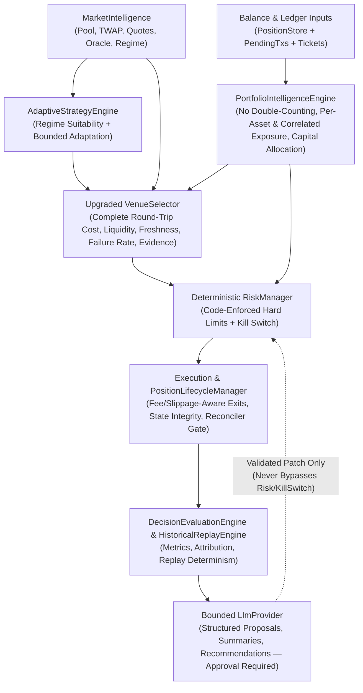

# Tranche Agent — Intelligence Upgrade Plan

**Phase 1 Deliverable — Repository & Architecture Assessment**

---

## 1. Current Architecture & Limitations

### Current Decision Pipeline (`agent/src/`)
The current autonomous agent (`TrancheAutonomousAgent` in `agent/src/runtime.ts` + `AgentRuntime` scheduler) executes a deterministic single-pair loop:

1. **Reconciliation (`reconciler.ts`)**: Clears confirmed/reverted/replaced pending transactions before starting a cycle (skipped in `read_only` mode).
2. **Market Snapshot (`market.ts`)**: `MarketIntelligence.collectSnapshot()` reads a single HSKSwap V3 pool (`slot0`, `liquidity`, `observe` 30m TWAP), simulates `quoteBuyInventory` / `quoteSellInventory` for a fixed `intent.targetAmount`, checks an `OracleReader`, evaluates Tranche offers via `TrancheExecutionAgent.evaluateOffers()`, computes rolling range-based volatility, momentum, TWAP dislocation, and classifies `MarketRegime` (`CALM | TRENDING | VOLATILE | DISLOCATED`).
3. **Position & Ticket Management (`runtime.ts`, `strategy.ts`, `positions.ts`)**: Loops over open positions (`evaluatePositionExit` using raw `exitQuote.paymentAmountOut - remainingCostBasisPayment`) and active tickets (`evaluateActiveTicket`).
4. **Entry Evaluation (`strategy.ts`, `venue.ts`, `risk.ts`)**:
   - `StrategyEngine.evaluateEntry()` runs a single static `strategyConfig.type` (`momentum | price_threshold | volatility_aware`) without adapting to `snapshot.marketRegime`.
   - `VenueSelector.selectVenue()` compares `trancheAcq` vs `dexAcq` using entry acquisition cost + optional gas, plus an optional bounded-downside override in `volatility_aware` mode.
   - `RiskManager.evaluateEntry()` enforces global caps (`maxPositionSizeInventory`, `maxTotalExposurePayment`, `maxDailyPremiumBudgetPayment`, `maxDailyRealizedLossPayment`, `maxConcurrentPositions`, `maxConcurrentTickets`, `maxSlippageBps`, `minPoolLiquidity`, oracle guards, `paused`, `killSwitch`, `no_pending_tx`).
5. **Persistence (`positions.ts`)**: `PositionStore` persists `positions`, `tickets`, `pendingTxs`, `daily`, `executedDecisionKeys`, and `runtimeConfig` (versioned policy history + rollback) atomically to JSON with `.bak` backup and `.lock` file.
6. **LLM Layer (`llm.ts`)**: `LlmProvider` (`LocalRuleBasedLlmProvider`) only exposes `parseInstruction()` and `explainTrace()`.
7. **HTTP API (`server.ts`) & Frontend (`web/src/pages/AgentPage.tsx`)**: Exposes health/ready/status/metrics/markets/decisions/positions/tickets/config/soak + authenticated control/policy/reconcile endpoints, plus completely isolated `/hsp/payments*` endpoints.

### Key Architectural Limitations Identified
1. **Trade-in-Isolation vs. Portfolio Awareness**:
   - `PositionStore.getPortfolioState()` only aggregates flat totals (`openPositionsCount`, `activeTicketsCount`, `currentTotalExposurePayment`). It does not track available payment balances, per-asset capital allocation, reserved capital vs. exercise obligation, pending transaction capital reservations (risking double-counting or over-allocation), or correlated asset exposure.
   - The agent always proposes the fixed `intent.targetAmount` instead of sizing or rejecting trades based on available capital, concentration caps, and portfolio improvement.
2. **Static Strategy Selection**:
   - `MarketIntelligence` already classifies `MarketRegime` (`CALM`, `TRENDING`, `VOLATILE`, `DISLOCATED`), but `StrategyEngine.evaluateEntry()` completely ignores `snapshot.marketRegime`.
   - There is no structured suitability gate for thin liquidity, elevated TWAP deviation, or regime mismatch, and no bounded regime-specific parameter adaptation.
3. **Incomplete Cross-Venue Cost Model**:
   - `VenueSelector` compares entry acquisition cost + entry gas, but does not model **expected exit costs** (exit slippage + exit swap fees + exit gas), **ticket expiry / exercise-window constraints**, **quote freshness**, or **measurable historical venue failure rate**.
   - Venue decisions produce a text rationale string rather than structured, auditable cost-component evidence.
4. **Position Lifecycle & State Integrity Gaps**:
   - `evaluatePositionExit()` does not subtract estimated exit gas/fees when evaluating take-profit/stop-loss, nor does it track realized slippage (`quoted` vs `actual`) or detect stale/inconsistent position state (e.g. negative/zero remaining quantity while `OPEN`, orphaned active tickets past expiry, or un-reconciled pending txs blocking lifecycle actions).
5. **No Decision Evaluation or Deterministic Replay**:
   - `TrancheAutonomousAgent` keeps in-memory `traces[]` only; there is no evaluation engine computing net P&L after fees, max drawdown, win/loss distribution, profit factor, Sharpe ratio, venue selection accuracy, execution-cost improvement, risk-limit violations, or missed/duplicate attempts.
   - There is no reproducible historical replay / scenario harness to validate strategy or venue changes before approval.
6. **Limited LLM Reasoning Surface**:
   - `llm.ts` lacks structured contracts for portfolio/market explanations, evaluation interpretation, and bounded strategy adjustment recommendations (which must require explicit approval and never mutate hard risk limits or `killSwitch`).

---

## 2. Proposed Upgraded Architecture

All new intelligence layers are **modular, deterministic, and strictly additive** — preserving existing behavior when not explicitly enabled, keeping `HspPaymentOrchestrator` completely isolated, and never introducing live broadcasts.

---

## 3. New Modules & Responsibilities

| Module | Path | Responsibilities |
| --- | --- | --- |
| **Portfolio Intelligence** | `agent/src/portfolio.ts` | Computes `PortfolioSnapshot` (available payment balance, committed capital per asset, open positions, active Tranche tickets separated into sunk premium vs. contingent exercise obligation, pending tx reserved capital without double-counting, unrealized/realized P&L, daily exposure/loss, correlated exposure groups). Evaluates `evaluateAllocation()` to size trades and verify portfolio improvement against concentration & correlation limits. |
| **Adaptive Strategy Intelligence** | `agent/src/adaptive-strategy.ts` | Evaluates market suitability (anomalies, liquidity floor, oracle freshness, TWAP deviation, volatility band) and maps `MarketRegime` (`CALM`, `TRENDING`, `VOLATILE`, `DISLOCATED`) to bounded strategy selection & parameter adjustments. Explicitly returns `NONE`/`WAIT` when conditions are unsuitable. |
| **Cross-Venue Execution Intelligence** | `agent/src/venue.ts` (upgraded) | Extends `RouteCostBreakdown` & `VenueSelectionResult` with complete round-trip cost components: executable entry, protocol/swap fees, entry slippage, entry+exit gas, expected exit cost, reservation premium, ticket expiry/exercise window checks, quote freshness age, measurable venue failure probability, and structured `VenueDecisionEvidence`. |
| **Position & Lifecycle Management** | `agent/src/position-manager.ts` | Deterministic `PositionLifecycleManager`: fee- and slippage-adjusted exit evaluation, ticket expiry & exercise economics, stale/inconsistent state integrity checks (`auditStateIntegrity()`), and hard gate requiring pending-tx reconciliation before mutating positions. |
| **Decision Evaluation & Replay** | `agent/src/evaluation.ts` | `DecisionEvaluationEngine` & `HistoricalReplayEngine`: captures decision records with provenance (`LIVE | FORK | REPLAY | MOCK`), computes net P&L after fees, max drawdown, win/loss distribution, profit factor, Sharpe ratio (when sample size & variance permit), venue accuracy, execution-cost improvement, risk violations, and missed/duplicate counts. Runs deterministic scenario/historical replays. |
| **Upgraded LLM Reasoning** | `agent/src/llm.ts` (upgraded) | Extends `LlmProvider` with structured, validated outputs for NL objectives, strategy proposals, market/portfolio explanations, decision summaries, evaluation interpretation, and bounded strategy adjustment recommendations (strictly advisory until explicitly approved). Rejects malformed/adversarial outputs and falls back deterministically. |

---

## 4. Data Requirements & Provenance

- **On-chain / Market Inputs**: Pool `spotPriceX36`, 30m `twapPriceX36`, `liquidity`, `dexBuyQuote`, `dexSellQuote`, `oracle` reading + age + deviation, live `trancheOffers`, gas price estimates, and optional wallet/available payment balance.
- **No Fabricated Data**: Missing quotes, empty Tranche offer lists, or insufficient correlation history are represented explicitly (`null` / `"INSUFFICIENT_DATA"`) — never fabricated.
- **Data Provenance Tagging**: Every evaluation, replay, and API payload explicitly carries `dataProvenance: "LIVE" | "FORK" | "REPLAY" | "MOCK"` so the frontend never confuses replay/mock outputs with live production performance.

---

## 5. Integration Points

1. **`agent/src/runtime.ts`**:
   - Add optional `intelligence?: AgentIntelligenceConfig` to `TrancheAutonomousAgentConfig` (disabled/pass-through by default so all 47 existing tests preserve exact behavior).
   - When enabled, `runCycle()` incorporates `PortfolioIntelligenceEngine`, `AdaptiveStrategyEngine`, upgraded `VenueSelector`, `PositionLifecycleManager`, and records structured decision evaluations into `DecisionEvaluationEngine`.
   - `AutonomousDecisionTrace` gains optional `portfolioSnapshot`, `allocationDecision`, `adaptiveStrategy`, `positionIntegrity`, and `evaluationRecord` fields.
2. **`agent/src/server.ts`**:
   - Preserve all existing endpoints, Bearer auth, CORS, rate limiting, and isolated `/hsp/payments*` routes.
   - Add additive read endpoints: `GET /agent/portfolio`, `GET /agent/evaluation`, `GET /agent/intelligence` (regime, adaptive strategy, venue evidence, position integrity) and authenticated `POST /agent/evaluation/replay` & `POST /agent/policy/recommend` (advisory only — requires explicit approval via existing policy apply flow).
3. **`web/src/lib/agentApi.ts` & `web/src/pages/AgentPage.tsx`**:
   - Expose Portfolio Overview, Asset Exposure, Strategy & Market Regime, Venue Decision Explanations, Position Lifecycle, Decision History, and Performance/Evaluation metrics with clear `LIVE / FORK / REPLAY / MOCK` provenance badges.

---

## 6. Testing & Evaluation Strategy

Add dedicated unit, integration, and adversarial test suites covering all 12 required areas:
1. Portfolio capital allocation & sizing under balance/concentration constraints.
2. Per-asset & correlated exposure aggregation.
3. Duplicate capital accounting prevention (positions + active tickets + pending txs never double-counted).
4. Regime-dependent strategy selection (`CALM`, `TRENDING`, `VOLATILE`, `DISLOCATED` + unsuitable -> `NONE`).
5. Stale market data & oracle deviation gating.
6. Cross-venue comparison under thin vs. deep liquidity, high slippage, stale quotes, tight expiry, and venue failure history.
7. Position lifecycle transitions, fee/slippage-aware TP/SL, and stale/inconsistent state detection.
8. Transaction reconciliation gating before new actions.
9. Risk enforcement (hard limits & kill switch cannot be bypassed).
10. LLM malformed, out-of-bounds, and adversarial outputs (e.g., attempting to clear `killSwitch` or inject unknown fields).
11. Historical replay determinism (identical scenario inputs produce bit-for-bit identical metrics & decisions).
12. Restart recovery preserving portfolio, policy, pending txs, and kill switch.

---

## 7. Migration & Backward-Compatibility Considerations

- **`PersistedAgentState` (`version: 1`)**: All new fields on `TrackedPosition` / `TrackedTicket` are strictly optional; existing state files load cleanly with zero migration breakage.
- **Opt-In Activation**: `TrancheAutonomousAgent` preserves legacy single-strategy behavior unless `intelligence` options are explicitly enabled, guaranteeing zero regressions across existing unit, fork, and soak tests.
- **Operational Isolation**:
  - `HspPaymentOrchestrator` remains 100% isolated from trading execution.
  - Chain 177 read-only soak mode and systemd services are untouched.
  - No live trading broadcasts are introduced.
