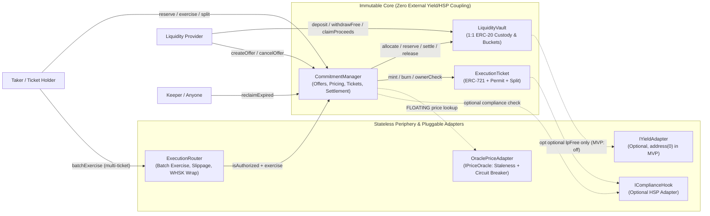
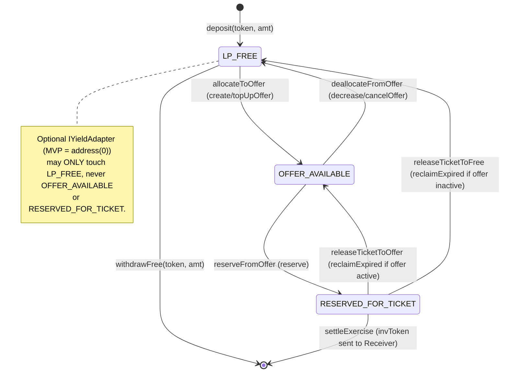
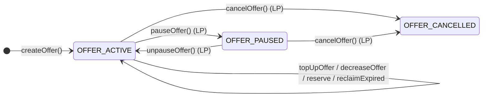
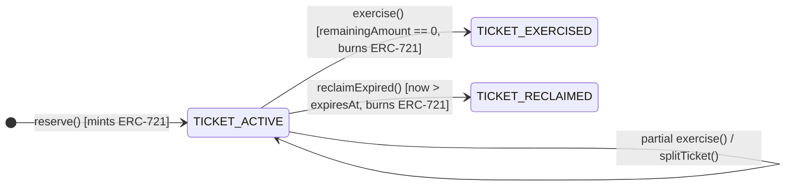

# Protocol Architecture Specification (Workstream C)

> **Status:** Phase 1 Architecture Design (No Solidity implementation in `contracts/src/` yet)  
> **Internal Name:** **the protocol**  
> **Target Toolchain (`VERIFIED` in [foundry.toml](file:///c:/Users/USER/Desktop/Tranche/foundry.toml)):** `solc 0.8.24`, `evm_version = "shanghai"`, `optimizer = true (200)`, `via_ir = false`, Foundry `1.7.1` (`VERIFIED` in [README.md](file:///c:/Users/USER/Desktop/Tranche/README.md)).

---

## 0. Verification Status Legend

Every external dependency, chain property, or integration claim in this document is explicitly tagged:

| Tag | Meaning |
| --- | --- |
| `VERIFIED` | Directly observed in workspace files or tool outputs in this session. |
| `ASSUMED` | Working assumption used for design; requires Workstream A/B confirmation before Phase 2 coding. |
| `INFERRED` | Derived logically from verified facts or standard EVM/DeFi mechanics. |
| `UNVERIFIED` | External contract address, ABI, oracle feed, or chain capability not yet inspected on-chain. |

---

## 1. Executive Summary

**the protocol** enables Liquidity Providers (LPs) to offer **inventory-backed, time-bounded execution commitments** that Takers can price, reserve upfront as transferable ERC-721 `ExecutionTicket`s, split, aggregate in batches, and exercise atomically—either at a **fixed price** or at a **floating oracle-referenced price plus spread**.

After reconciling four candidate architectures, this specification recommends **Architecture 4: a Modular ERC-20 Segregated Commitment Vault with Dual-Mode Execution Tickets and an Optional Idle-Yield Boundary (`IYieldAdapter`, `address(0)` in MVP)**. This is the smallest architecture that preserves every core innovation while eliminating Uniswap/HSKSwap V3 tick-shift insolvency, external callback coupling, and compliance-lockup hazards from the critical settlement path.

---

## 2. Paradigm Comparison: AMM vs. Segregated Inventory vs. Fixed-Price RFQ vs. Floating-Price Execution Commitment

A frequent point of confusion in liquidity design is treating all on-chain execution as variations of AMM pools or RFQs. The four paradigms differ fundamentally in **custody geometry**, **price formation**, **LP risk**, and **composability**:

| Dimension | 1. AMM Liquidity Provision (e.g., HSKSwap V3 `UNVERIFIED`) | 2. Segregated Inventory Execution | 3. Fixed-Price RFQ (Off-chain Signed Quotes) | 4. Floating-Price Execution Commitment (**the protocol**) |
| --- | --- | --- | --- | --- |
| **Inventory Custody** | Shared curve (`x*y=k` or concentrated ticks); token ratio shifts continuously with spot price. | Explicitly partitioned ERC-20 custody (`free`, `offerAvailable`, `reserved`); 1:1 token backing. | Unbacked off-chain quote until settlement tx; maker can move/withdraw funds before fill ("last-look" / revert). | Segregated 1:1 ERC-20 inventory locked on-chain at reservation; zero last-look after ticket mint. |
| **Time Guarantee** | Zero temporal guarantee; LP can withdraw at block $N+1$. | Guaranteed for `[reservedAt, expiresAt]` once reserved. | Ephemeral TTL (typically 10–60s); fails if maker cancels or pulls balance. | Guaranteed execution capacity over `[reservedAt, expiresAt]` (minutes to days). |
| **Price Formation** | Continuous curve price impact proportional to trade size vs. pool depth. | Determined by commitment terms (Fixed or Floating) up to reserved notional. | Fixed price quoted off-chain by maker for exact size. | `oraclePrice * (1 + spreadBps)` (with optional LP floor / taker cap); **zero size-based price impact** up to reserved depth. |
| **LP Risk Profile** | **Impermanent Loss (IL) / LVR** to arbitrageurs on every price move; continuous rebalancing. | Pure single-sided directional inventory exposure; **zero curve IL**. | Inventory & short-TTL adverse selection during quote window. | **No free fixed-strike option** (strike floats with oracle); LP earns upfront reservation premium + spread. |
| **Taker Value Prop** | Always-on permissionless swaps, but high slippage on thin pools (`ASSUMED` on HashKey Chain). | Deterministic settlement backed by locked tokens. | Zero slippage for small TTL, but non-transferable and single-shot. | **Guaranteed future depth + zero price impact + MEV/sandwich resistance** across arbitrary holding window. |
| **Ticket Rights & Composability** | Fungible LP share (ERC-20/NFT position), not an execution right. | Supports ERC-721 execution rights if tokenized. | Non-transferable, non-splittable, non-aggregatable without off-chain solver. | **Transferable ERC-721**, **partially exercisable**, **splittable**, and **batch-aggregatable** via `ExecutionRouter`. |

### Key Takeaway
- **Fixed-Price Commitments** inside **the protocol** behave like **fully collateralized, transferable, partially exercisable American options** (upgrading RFQ from unbacked ephemeral quotes into backed, composable on-chain rights priced with explicit upfront time-value premiums).
- **Floating-Price Commitments** inside **the protocol** solve a distinct market failure: **decoupling execution depth certainty from directional strike risk**. On newer L2s where continuous AMM pools may be thin (`ASSUMED` pending Workstream B market data), Takers can lock deep zero-impact execution capacity without forcing LPs to write underpriced fixed-strike options or suffer V3 LVR.

---

## 3. Candidate Architecture Reconciliation

We evaluated four candidate architectures against five criteria: (a) deterministic solvency, (b) preservation of the dual-mode transferable/aggregatable commitment innovation, (c) external dependency risk on HashKey Chain (`UNVERIFIED`), (d) capital efficiency, and (e) audit/hackathon verification surface.

### 3.1 Comparison Matrix

| Criterion | (1) Dedicated Depth Tranche (Claude) | (2) JIT-Segregated V3 Vault + Dual-Mode Tickets (Gemini) | (3) Pure ERC-20 Segregated Vault (No V3) | (4) Recommended: Modular ERC-20 Vault + Dual-Mode Tickets + Optional `IYieldAdapter` |
| --- | --- | --- | --- | --- |
| **Core Mechanism** | Separate tranche vaults per commitment pool; pure token custody. | Idle capital sits in HSKSwap V3 LP NFT; pulled JIT on ticket reservation; dual-mode tickets. | Single ERC-20 custody vault + dual-mode tickets + router. | Pure ERC-20 custody for all `offerAvailable` & `reserved` balances; optional bounded `IYieldAdapter` for `lpFree` only (`address(0)` in MVP). |
| **Reservation Determinism** | High (1:1 ERC-20). | **FRAGILE**: If V3 spot moves, position ratio shifts to the wrong token, causing `reserve()` revert or forced swap slippage. | **100% Deterministic** (1:1 ERC-20). | **100% Deterministic** (all offer & reserved inventory physically held in ERC-20). |
| **Solvency & Audit Surface** | Medium (tranche proliferation / duplication). | **High Risk**: Coupled to V3 `NonfungiblePositionManager`, tick math, fee `collect()`, callback reentrancy, and LP share drift. | **Minimal & Clean**. | **Minimal & Clean** in MVP (`yieldAdapter == address(0)`); clean extension seam if yield is added post-MVP. |
| **Dual-Mode & Aggregation** | Fixed/tranche-focused unless extended. | Yes (strongest insight from Arch 2). | Yes. | **Yes** (`FIXED` + `FLOATING`, partial fill, split, `ExecutionRouter` batching). |
| **Idle Capital Efficiency** | 0% idle yield. | High (earns V3 fees), at cost of V3 IL & conversion failure. | 0% idle yield (earns reservation premiums + spreads). | Earn premiums + spreads in MVP; optional isolated `IYieldAdapter` for unallocated `lpFree` later without touching active tickets. |
| **HashKey Chain Resilience** | High. | **Blocked/Fragile** if HSKSwap V3 ABI/liquidity/periphery differs (`UNVERIFIED`). | High (standard ERC-20 + abstracted `IPriceOracle`). | **High** (zero hard dependency on HSKSwap V3 or HSP). |

### 3.2 Recommendation: Architecture 4 (Minimal Innovation-Preserving Architecture)

We adopt **Architecture 4**, which unifies:
- **Architecture 1 & 3's custody discipline**: Physical 1:1 ERC-20 segregation in a single `LiquidityVault` with per-`(lp, token)` and per-offer accounting.
- **Architecture 2's execution expressiveness**: Dual-mode (`FIXED` and `FLOATING`) commitments, ERC-721 `ExecutionTicket`s with partial fill & splitting, and `ExecutionRouter` multi-ticket atomic aggregation.
- **Strict isolation of external dependencies**:
  - **V3 / Idle Yield**: Abstracted behind an optional `IYieldAdapter` on `lpFree` only, defaulting to `address(0)` (disabled) in MVP so HSKSwap V3 unknowns (`UNVERIFIED`) cannot jeopardize core solvency.
  - **Oracles**: Abstracted behind `IPriceOracle` with staleness, bounds, and circuit breakers.
  - **HSP Compliance**: Isolated behind an optional per-offer `IComplianceHook` (`address(0)` for permissionless offers) that is **never** called during withdrawals or expired-ticket reclaims.

### 3.3 System Architecture & Value Flow



---

## 4. Core Contract Specifications

> **Note:** Solidity-syntax blocks below are interface/architecture specifications only. No `.sol` files are placed in `contracts/src/` during Phase 1.

### 4.1 `LiquidityVault`

**Responsibility:** Sole custody contract for all protocol ERC-20 tokens (`inventoryToken`, `paymentToken`, earned premiums/proceeds, and protocol fees). Enforces strict accounting segregation across five non-overlapping buckets per token and never allows active commitments (`reserved`), LP proceeds, or protocol fees to be deployed externally or withdrawn by unauthorized actors.

#### 4.1.1 Vault Inventory State Machine (Per-Token Accounting Buckets)



Separate inflow buckets (`PENDING_PROCEEDS` and `PROTOCOL_FEES`):
- On `reserve()`: `paymentToken` premium enters -> split into `PENDING_PROCEEDS[lp][payToken]` + `PROTOCOL_FEES[payToken]`.
- On `exercise()`: `paymentToken` notional enters -> split into `PENDING_PROCEEDS[lp][payToken]` + `PROTOCOL_FEES[payToken]`.
- `PENDING_PROCEEDS` exits only via `claimProceeds()` (pull-only by LP, never blocked by pause).
- `PROTOCOL_FEES` exits only via `withdrawProtocolFees()` by `FEE_COLLECTOR`.

#### 4.1.2 Storage Layout

```solidity
// Roles: DEFAULT_ADMIN_ROLE / GUARDIAN, MANAGER_ROLE (CommitmentManager), FEE_COLLECTOR_ROLE
address public manager;          // CommitmentManager (immutable or single-step set-once at deploy)
address public feeCollector;
address public guardian;
bool    public depositsPaused;   // Emergency flag: pauses new deposits/allocations ONLY; NEVER blocks withdrawFree or claimProceeds

// Per-LP unallocated free balance: lp => token => amount
mapping(address => mapping(address => uint256)) public lpFreeBalance;
// Per-Offer available (unreserved) balance: offerId => amount
mapping(uint64 => uint256) public offerBalance;
// Per-Ticket reserved balance: ticketId => amount
mapping(uint256 => uint256) public ticketReserved;
// Per-LP earned proceeds (premiums + fills): lp => token => amount
mapping(address => mapping(address => uint256)) public lpPendingProceeds;
// Protocol accumulated fees: token => amount
mapping(address => uint256) public protocolFees;

// Global per-token bucket totals (O(1) invariant checks)
mapping(address => uint256) public totalLpFree;
mapping(address => uint256) public totalOfferAvailable;
mapping(address => uint256) public totalReserved;
mapping(address => uint256) public totalPendingProceeds;
// Note: protocolFees[token] is already the global total for protocol fees.

// Optional Idle Yield Adapter (MVP: all zero / disabled)
mapping(address => address) public yieldAdapter;       // token => IYieldAdapter (address(0) in MVP)
mapping(address => uint256) public totalDeployedIdle;  // token => deployed amount (0 in MVP)
mapping(address => uint16)  public maxIdleDeployBps;   // cap on % of totalLpFree deployable
```

#### 4.1.3 Core Interface (`ILiquidityVault`)

```solidity
interface ILiquidityVault {
    // --- LP Custody (Permissionless, nonReentrant) ---
    function deposit(address token, uint256 amount) external;
    function withdrawFree(address token, uint256 amount, address to) external;       // NEVER paused
    function claimProceeds(address token, uint256 amount, address to) external;      // NEVER paused

    // --- Manager-Only State Transitions (onlyManager, nonReentrant) ---
    function allocateToOffer(address lp, address token, uint64 offerId, uint256 amount) external;
    function deallocateFromOffer(address lp, address token, uint64 offerId, uint256 amount) external;
    function reserveFromOffer(uint64 offerId, uint256 ticketId, address token, uint256 amount) external;
    function splitTicketReserved(uint256 fromTicketId, uint256 toTicketId, uint256 splitAmount) external;
    function releaseTicketToOffer(uint256 ticketId, uint64 offerId, address token, uint256 amount) external;
    function releaseTicketToFree(uint256 ticketId, address lp, address token, uint256 amount) external;
    function collectFeeAndProceeds(
        address payer,
        address payToken,
        address lp,
        uint256 lpNetProceeds,
        uint256 protocolFee
    ) external;
    function settleExercise(
        uint256 ticketId,
        address invToken,
        uint256 invAmount,
        address payer,
        address payToken,
        address lp,
        uint256 lpNetProceeds,
        uint256 protocolFee,
        address receiver
    ) external;

    // --- Governance / Fee Collector ---
    function withdrawProtocolFees(address token, address to) external;
    function setDepositsPaused(bool paused) external;
}
```

**ERC-20 Token Hygiene Rules in `LiquidityVault`:**
- All inbound token transfers (`deposit`, `collectFeeAndProceeds`, `settleExercise`) measure `balBefore = IERC20(token).balanceOf(address(this))` and `balAfter`, requiring `balAfter - balBefore == expectedAmount`. Fee-on-transfer and rebasing tokens revert with `UnsupportedTokenBalanceDelta`.
- All transfers use OpenZeppelin `SafeERC20`.

---

### 4.2 `CommitmentManager`

**Responsibility:** Owns the lifecycle of `CommitmentOffer`s and `ExecutionTicket` terms, computes deterministic pricing/fees/rounding, enforces offer and ticket bounds, coordinates `LiquidityVault` transitions and `ExecutionTicket` mint/burn, and isolates optional `IComplianceHook` calls.

#### 4.2.1 Offer & Ticket State Machines





> **Immutability Rule:** `pauseOffer()` and `cancelOffer()` ONLY affect future `reserve()` calls and unreserved `offerBalance`. They **never** alter, freeze, or revoke existing `TICKET_ACTIVE` tickets.

#### 4.2.2 Storage Layout (Slot-Packed for `solc 0.8.24`)

```solidity
enum PriceMode { FIXED, FLOATING }      // uint8
enum OfferStatus { ACTIVE, PAUSED, CANCELLED } // uint8
enum TicketStatus { NONE, ACTIVE, EXERCISED, RECLAIMED } // uint8

struct Offer {
    // Slot 0 (32 bytes)
    address lp;                 // 20B
    uint40  createdAt;          // 5B
    uint40  expiry;             // 5B (unix ts after which no new reservations allowed)
    PriceMode priceMode;        // 1B
    OfferStatus status;         // 1B
    // Slot 1 (32 bytes)
    address inventoryToken;     // 20B (token delivered by LP on exercise)
    uint32  minDuration;        // 4B  (seconds)
    uint32  maxDuration;        // 4B  (seconds)
    uint16  basePremiumBps;     // 2B  (flat reservation fee in bps of notional)
    uint16  dailyPremiumBps;    // 2B  (time-proportional fee in bps per 86400s)
    // Slot 2 (32 bytes)
    address paymentToken;       // 20B (token paid by Taker on reserve & exercise)
    int16   spreadBps;          // 2B  (for FLOATING: signed bps added to oracle price)
    uint80  _reserved;          // 10B spare
    // Slot 3 (20 bytes)
    address oracle;             // 20B (IPriceOracle; address(0) allowed only if FIXED)
    // Slot 4 (20 bytes)
    address complianceHook;     // 20B (IComplianceHook; address(0) = permissionless)
    // Slot 5..8
    uint256 minFillAmount;      // Minimum inventoryToken amount per reserve()
    uint256 fixedPriceX36;      // FIXED: raw paymentToken per raw inventoryToken * 1e36
    uint256 minPriceX36;        // FLOATING: LP worst-case price floor (0 = none)
    uint256 maxPriceX36;        // FLOATING: optional price cap (0 = uncapped)
}

struct Ticket {
    // Slot 0 (22 bytes used, 10 spare)
    uint64  offerId;            // 8B
    uint40  reservedAt;         // 5B
    uint40  expiresAt;          // 5B  (exercisable while block.timestamp <= expiresAt)
    PriceMode priceMode;        // 1B
    TicketStatus status;        // 1B
    int16   spreadBps;          // 2B  (snapshotted at reserve)
    // Slot 1..5 (terms snapshotted at reserve; immune to later Offer edits)
    address lp;
    address inventoryToken;
    address paymentToken;
    address oracle;
    address complianceHook;
    // Slot 6..9
    uint256 initialAmount;      // Initial reserved inventoryToken
    uint256 remainingAmount;    // Unexercised inventoryToken (always == vault.ticketReserved[ticketId])
    uint256 fixedOrMinPriceX36; // fixedPriceX36 if FIXED; minPriceX36 if FLOATING
    uint256 maxPriceX36;        // maxPriceX36 if FLOATING (0 = uncapped)
}

// State variables
ILiquidityVault public immutable vault;
IExecutionTicket public immutable ticketNft;
uint64  public nextOfferId = 1;
uint256 public nextTicketId = 1;
uint16  public protocolFeeBps;           // Bounded by MAX_PROTOCOL_FEE_BPS (e.g., 500 = 5%)
uint256 public minTicketAmount;          // Dust guard for reserve() and splitTicket()
bool    public newReservationsPaused;    // Emergency flag: pauses createOffer & reserve ONLY; NEVER blocks exercise or reclaimExpired!

mapping(uint64 => Offer)   public offers;
mapping(uint256 => Ticket) public tickets;
```

#### 4.2.3 Pricing, Fee & Rounding Specification (`priceX36`)

**Price Representation (`priceX36`):**
$$\text{priceX36} = \left\lfloor \frac{\text{raw paymentToken units}}{\text{raw inventoryToken units}} \times 10^{36} \right\rfloor$$

Why `priceX36` instead of 18-decimal human price?
- Handles extreme decimal asymmetries (e.g., 6-dec `USDC` vs. 18-dec `WHSK` or 8-dec `WBTC` vs. 18-dec token) with at least 14–36 digits of precision and **zero runtime `.decimals()` calls** on ERC-20 contracts.
- Every conversion uses 512-bit `Math.mulDiv` (`OpenZeppelin`), preventing intermediate overflow.

**Exact Formulas:**
1. **Effective Execution Price (`_resolvePriceX36`)**:
   - If `FIXED`: `effPriceX36 = ticket.fixedOrMinPriceX36`.
   - If `FLOATING`:
     - Fetch `quote = IPriceOracle(ticket.oracle).getPriceX36(ticket.inventoryToken, ticket.paymentToken)`.
     - Require `quote.isValid && quote.priceX36 > 0`.
     - Apply signed spread: `effPriceX36 = Math.mulDiv(quote.priceX36, uint256(int256(10_000) + int256(ticket.spreadBps)), 10_000, Math.Rounding.Ceil)`.
     - Clamp or enforce bounds:
       - If `ticket.fixedOrMinPriceX36 > 0 && effPriceX36 < ticket.fixedOrMinPriceX36`: `effPriceX36 = ticket.fixedOrMinPriceX36` (protects LP floor even if market drops—wait: LP floor means LP refuses to sell below `minPriceX36`, so clamping up to `minPriceX36` guarantees LP never receives less than `minPriceX36`, while Taker is protected by `maxPaymentIn`!).
       - If `ticket.maxPriceX36 > 0 && effPriceX36 > ticket.maxPriceX36`: `effPriceX36 = ticket.maxPriceX36` (Wait: clamping down vs reverting? If `minPriceX36 > maxPriceX36` at offer creation, revert `InvalidPriceBounds`. Clamping to `[minPriceX36, maxPriceX36]` gives predictable collar semantics, or reverting protects LP/Taker if out-of-band. Let's make **collar clamping** the default and document it explicitly—wait: what if an LP set `maxPriceX36` as a cap for Taker? Clamping gives Taker the cap! Note: an LP shouldn't set `maxPriceX36` unless they actually consent to selling at `maxPriceX36`, so `maxPriceX36 = 0` (uncapped) is the default for LPs!).
2. **Reservation Premium (`quoteReservationPremium`)**:
   - Reference price at reservation (`refPriceX36`): `fixedPriceX36` for `FIXED`; `oracle` price (clamped to `[minPriceX36, maxPriceX36]`) for `FLOATING`.
   - Effective premium bps:
     $$\text{effPremiumBps} = \text{basePremiumBps} + \left\lceil \frac{\text{dailyPremiumBps} \times \text{duration}}{86400} \right\rceil$$
   - Notional in `paymentToken`:
     $$\text{notionalPay} = \text{Math.mulDiv}(\text{inventoryAmount}, \text{refPriceX36}, 10^{36}, \text{Ceil})$$
   - Gross premium:
     $$\text{grossPremium} = \text{Math.mulDiv}(\text{notionalPay}, \text{effPremiumBps}, 10\_000, \text{Ceil})$$
   - Fee split:
     $$\text{protocolFee} = \text{Math.mulDiv}(\text{grossPremium}, \text{protocolFeeBps}, 10\_000, \text{Floor})$$
     $$\text{lpNetPremium} = \text{grossPremium} - \text{protocolFee}$$
3. **Exercise Settlement (`quoteExercise`)**:
   - Gross payment:
     $$\text{grossPayment} = \text{Math.mulDiv}(\text{fillAmount}, \text{effPriceX36}, 10^{36}, \text{Ceil})$$
   - Fee split:
     $$\text{protocolFee} = \text{Math.mulDiv}(\text{grossPayment}, \text{protocolFeeBps}, 10\_000, \text{Floor})$$
     $$\text{lpNetProceeds} = \text{grossPayment} - \text{protocolFee}$$

**Rounding Conservation:**
- `grossPayment` and `grossPremium` ALWAYS round **UP (`Ceil`)** against the Taker, preventing 1-wei micro-fill extraction.
- `protocolFee` rounds **DOWN (`Floor`)** and `lpNet = gross - protocolFee`, guaranteeing `lpNet + protocolFee == gross` with zero lost wei.

#### 4.2.4 Core Interface (`ICommitmentManager`)

```solidity
interface ICommitmentManager {
    struct CreateOfferParams {
        address inventoryToken;
        address paymentToken;
        uint256 initialAmount;
        uint256 minFillAmount;
        uint40  expiry;
        uint32  minDuration;
        uint32  maxDuration;
        uint16  basePremiumBps;
        uint16  dailyPremiumBps;
        PriceMode priceMode;
        int16   spreadBps;
        address oracle;
        address complianceHook;
        uint256 fixedPriceX36;
        uint256 minPriceX36;
        uint256 maxPriceX36;
    }

    // --- LP Offer Management ---
    function createOffer(CreateOfferParams calldata params) external returns (uint64 offerId);
    function topUpOffer(uint64 offerId, uint256 addAmount) external;
    function decreaseOffer(uint64 offerId, uint256 removeAmount) external; // NEVER blocked by pause
    function pauseOffer(uint64 offerId) external;
    function unpauseOffer(uint64 offerId) external;
    function cancelOffer(uint64 offerId) external;                           // NEVER blocked by pause

    // --- Taker / Ticket Operations ---
    function reserve(
        uint64 offerId,
        uint256 inventoryAmount,
        uint32 duration,
        uint256 maxPremiumIn,
        address recipient
    ) external returns (uint256 ticketId);

    function exercise(
        uint256 ticketId,
        uint256 fillAmount,      // 0 means full remainingAmount
        uint256 maxPaymentIn,
        address receiver
    ) external returns (uint256 actualFill, uint256 grossPayment);           // NEVER blocked by pause

    function splitTicket(
        uint256 ticketId,
        uint256 splitAmount,
        address recipient
    ) external returns (uint256 newTicketId);

    // --- Permissionless Expiry Reclaim ---
    function reclaimExpired(uint256 ticketId) external;                      // NEVER blocked by pause
    function reclaimExpiredBatch(uint256[] calldata ticketIds) external;     // NEVER blocked by pause

    // --- Views ---
    function quoteReservation(uint64 offerId, uint256 inventoryAmount, uint32 duration)
        external view returns (uint256 grossPremium, uint256 protocolFee);
    function quoteExercise(uint256 ticketId, uint256 fillAmount)
        external view returns (uint256 actualFill, uint256 grossPayment, uint256 effPriceX36);
    function getOffer(uint64 offerId) external view returns (Offer memory);
    function getTicket(uint256 ticketId) external view returns (Ticket memory);
}
```

---

### 4.3 `ExecutionTicket` (ERC-721 + EIP-712 Permit + Optional Compliance Hook)

**Responsibility:** Canonical ERC-721 ownership & approval ledger for execution rights. Delegates all settlement & notional accounting to `CommitmentManager` so ticket terms cannot drift.

**Key Design Properties:**
- Inherits OpenZeppelin `ERC721` + `EIP712` (for gasless `permit(spender, tokenId, deadline, v, r, s)` / `permitAll` optional).
- `mint(address to, uint256 ticketId)` and `burn(uint256 ticketId)` are `onlyManager`.
- Exposes `isAuthorized(address spender, uint256 ticketId) external view returns (bool)`: returns `true` iff `spender == owner || getApproved(ticketId) == spender || isApprovedForAll(owner, spender)`.
- In `_update(address to, uint256 tokenId, address auth)`:
  - When transferring (`from != address(0) && to != address(0)`):
    - Queries `Ticket memory t = manager.getTicket(tokenId)`.
    - Optionally blocks transfer of already-expired tickets? Allowing transfer until burned or letting `reclaimExpired` burn anytime is fine (if `reclaimExpired` runs, `burn` sets `from != 0, to == 0` which MUST NOT call `complianceHook`).
    - If `t.complianceHook != address(0)`, calls `IComplianceHook(t.complianceHook).beforeTransfer(tokenId, from, to)`. (Skipped on mint/burn; `reserve` and `exercise` handle their own explicit hook checks).
- Dynamic `tokenURI(uint256 tokenId)` reads `manager.getTicket(tokenId)` so marketplaces/wallets see live `remainingAmount`, `expiresAt`, `priceMode`, and pair details.

---

### 4.4 `ExecutionRouter` (Stateless Batch Aggregator)

**Responsibility:** Enables atomic multi-ticket aggregation (`batchExercise`) across multiple LPs, offers, and mixed `FIXED`/`FLOATING` modes in one transaction with global slippage (`minTotalInventoryOut`, `maxTotalPaymentIn`) and `deadline` guarantees, plus optional `WHSK` native wrapping/unwrapping (`UNVERIFIED` `WHSK` address pending Workstream A).

**Security Rule (Mandatory Authorization Check):**
Because users grant `setApprovalForAll(executionRouter, true)` once for convenience, `ExecutionRouter` MUST verify `ticketNft.isAuthorized(msg.sender, leg.ticketId)` on **every single leg** before calling `commitmentManager.exercise(...)`. Without this check, a malicious caller could pass another user's `ticketId` and hijack their approval.

```solidity
interface IExecutionRouter {
    struct ExerciseLeg {
        uint256 ticketId;
        uint256 fillAmount;       // 0 = full remainingAmount
        uint256 maxLegPaymentIn;  // per-leg safety cap
    }

    struct BatchExerciseParams {
        address inventoryToken;
        address paymentToken;
        uint256 minTotalInventoryOut;
        uint256 maxTotalPaymentIn;
        uint256 deadline;
        address receiver;
        bool    unwrapInventoryToNative;
        ExerciseLeg[] legs;
    }

    function batchExercise(BatchExerciseParams calldata params)
        external
        payable
        returns (uint256 totalInventoryOut, uint256 totalPaymentIn);
}
```

**Execution Flow (`batchExercise`, `nonReentrant`):**
1. Check `block.timestamp <= params.deadline` and `params.legs.length > 0`.
2. If `msg.value > 0`: require `params.paymentToken == WHSK` and `msg.value == params.maxTotalPaymentIn`, wrap `WHSK.deposit{value: msg.value}()`. Else pull `params.maxTotalPaymentIn` of `params.paymentToken` from `msg.sender` via `SafeERC20`.
3. Approve `vault` for `params.maxTotalPaymentIn` (only for duration of tx; reset excess/verify zero residual).
4. For each `leg` in `params.legs`:
   - Require `ticketNft.isAuthorized(msg.sender, leg.ticketId)`.
   - Read `t = manager.getTicket(leg.ticketId)` and require `t.inventoryToken == params.inventoryToken && t.paymentToken == params.paymentToken` (ensures homogeneous batch accounting).
   - Call `(actualFill, grossPay) = manager.exercise(leg.ticketId, leg.fillAmount, leg.maxLegPaymentIn, legReceiver)`.
   - Accumulate `totalInventoryOut += actualFill`, `totalPaymentIn += grossPay`.
5. Require `totalInventoryOut >= params.minTotalInventoryOut` and `totalPaymentIn <= params.maxTotalPaymentIn`.
6. Reset `vault` allowance to `0`.
7. Refund `unused = params.maxTotalPaymentIn - totalPaymentIn` to `msg.sender` (unwrapping if paid in native `HSK`).
8. If `params.unwrapInventoryToNative`: unwrap `totalInventoryOut` of `WHSK` and send native `HSK` to `params.receiver`.

---

### 4.5 Oracle / Reference-Price Adapter (`IPriceOracle` & `OraclePriceAdapter`)

**Responsibility:** Shields `CommitmentManager` from heterogeneous oracle implementations on HashKey Chain (`UNVERIFIED` pending Workstream A) and enforces strict freshness, bounds, and cross-feed circuit breakers.

```solidity
interface IPriceOracle {
    struct PriceQuote {
        uint256 priceX36;   // raw paymentToken per raw inventoryToken * 1e36
        uint256 updatedAt;  // observation timestamp
        bool    isValid;    // false if feed unhealthy / circuit breaker tripped
    }

    function getPriceX36(address inventoryToken, address paymentToken)
        external
        view
        returns (PriceQuote memory);
}
```

**`OraclePriceAdapter` Validation Pipeline (Per Pair `(inventoryToken, paymentToken)`):**
1. **Feed Config:** `primaryFeed` (e.g., Pyth/Chainlink/RedStone feed adapter `UNVERIFIED`), `secondaryFeed` (optional TWAP or backup push feed `UNVERIFIED`), `maxStaleness` (seconds), `maxDeviationBps` (e.g., `300` = 3%), `hardMinPriceX36`, `hardMaxPriceX36`, `decimalScaleFactor`, `allowSecondaryFallback`.
2. **Primary Read & Sanity:**
   - Must satisfy `price > 0`, `updatedAt <= block.timestamp`, and `block.timestamp - updatedAt <= maxStaleness`.
   - Must satisfy `hardMinPriceX36 <= priceX36 <= hardMaxPriceX36`.
3. **Secondary Cross-Check / Circuit Breaker (when `secondaryFeed != address(0)`):**
   - If secondary is fresh & valid: compute relative divergence $\Delta = \frac{|p_1 - p_2| \times 10\_000}{\min(p_1, p_2)}$. If $\Delta > \text{maxDeviationBps}$, return `isValid = false` (or revert `OracleDeviationExceeded`).
   - If primary is stale/down and `allowSecondaryFallback == true` and secondary is fresh & valid: return secondary quote (only if secondary is manipulation-resistant, e.g., >= 30-min TWAP or independent push oracle; **never** AMM `slot0` spot!).
   - Otherwise: fail closed (`isValid = false` -> `CommitmentManager` reverts `FLOATING` reserve/exercise).

---

### 4.6 Pluggable Compliance / HSP Adapter (`IComplianceHook`)

**Responsibility:** Optional per-offer hook enabling permissioned/KYC-gated tranches via HSP (`UNVERIFIED` pending Workstream A) while preserving **100% non-blocking core solvency and withdrawal guarantees**.

```solidity
interface IComplianceHook {
    function beforeCreateOffer(address lp, address inventoryToken, address paymentToken) external view;
    function beforeReserve(uint64 offerId, address taker, address recipient, uint256 amount) external view;
    function beforeTransfer(uint256 ticketId, address from, address to) external view;
    function beforeExercise(uint256 ticketId, address exerciser, address receiver) external view;
}
```

**Strict Trust Boundary Rules:**
1. **`LiquidityVault` has ZERO knowledge of `IComplianceHook` or HSP.**
2. **Never invoked on:** `withdrawFree`, `claimProceeds`, `decreaseOffer`, `cancelOffer`, `reclaimExpired`, `burn`, or `withdrawProtocolFees`. An HSP outage, upgrade, or attestation revocation can **never** freeze LP funds or prevent expired inventory recovery.
3. **View-only (`staticcall`) hook signature:** `IComplianceHook` methods are `view` (`staticcall` from `CommitmentManager` / `ExecutionTicket`), eliminating reentrancy from compliance hooks!
4. **Optionality:** `complianceHook == address(0)` is fully permissionless.

---

## 5. Roles & Access Control Matrix

| Role | Assigned To | Permitted Actions | Explicitly Forbidden Actions |
| --- | --- | --- | --- |
| **LP** | Any EOA/contract (gated by `IComplianceHook` only if chosen on offer) | `deposit`, `withdrawFree`, `claimProceeds`, `createOffer`, `topUpOffer`, `decreaseOffer`, `pauseOffer`, `unpauseOffer`, `cancelOffer` | Cannot withdraw `ticketReserved`, alter active `Ticket` terms, or block `exercise` before `expiresAt`. |
| **Taker / Ticket Holder** | Any address (subject to offer's optional `IComplianceHook`) | `reserve`, `exercise`, `splitTicket`, `transferFrom`, `approve`, `ExecutionRouter.batchExercise` | Cannot exercise after `expiresAt`, exercise `> remainingAmount`, or drain other holders' tickets via Router. |
| **Keeper / Anyone** | Permissionless | `reclaimExpired`, `reclaimExpiredBatch` (only when `block.timestamp > expiresAt`) | Cannot reclaim active unexpired tickets; cannot redirect released inventory away from LP/Offer. |
| **Governance / Admin** | Timelocked Multisig (Post-hackathon) / Deployer (MVP) | Set `protocolFeeBps` (capped `<= MAX_PROTOCOL_FEE_BPS`), set `minTicketAmount`, configure `OraclePriceAdapter` feeds, set `feeCollector` | **Cannot** withdraw/sweep LP `lpFree`, `offerBalance`, `ticketReserved`, or `lpPendingProceeds`; **cannot** mutate active offers/tickets or disable `withdrawFree`/`reclaimExpired`. |
| **Guardian** | Security Multisig | `setDepositsPaused(true)`, `setNewReservationsPaused(true)` (circuit-breaker pause on new inflows only) | **Cannot** pause `withdrawFree`, `claimProceeds`, `decreaseOffer`, `cancelOffer`, `exercise` (of existing valid tickets), or `reclaimExpired`. |
| **Fee Collector** | Treasury address | `withdrawProtocolFees(token, to)` | Cannot touch any non-fee balance bucket. |

---

## 6. Formal Accounting & Security Invariants

These invariants MUST hold before and after every transaction (and will be encoded directly as Foundry invariant tests in Phase 2):

1. **INV-1 (Vault Physical Solvency — Hard Invariant):**
   $$\forall \text{token}: \quad \text{IERC20}(\text{token}).\text{balanceOf}(\text{vault}) \ge \text{totalReserved}[\text{token}] + \text{totalPendingProceeds}[\text{token}] + \text{protocolFees}[\text{token}]$$
   *(And in MVP where `totalDeployedIdle[token] == 0`:)*
   $$\text{IERC20}(\text{token}).\text{balanceOf}(\text{vault}) \ge \text{totalLpFree}[\text{token}] + \text{totalOfferAvailable}[\text{token}] + \text{totalReserved}[\text{token}] + \text{totalPendingProceeds}[\text{token}] + \text{protocolFees}[\text{token}]$$

2. **INV-2 (Individual Bucket Sum Consistency):**
   - $\sum_{\text{lp}} \text{lpFreeBalance}[\text{lp}][\text{token}] == \text{totalLpFree}[\text{token}]$
   - $\sum_{\text{offer} \in \text{token}} \text{offerBalance}[\text{offer}] == \text{totalOfferAvailable}[\text{token}]$
   - $\sum_{\text{ticket} \in \text{token}} \text{ticketReserved}[\text{ticket}] == \text{totalReserved}[\text{token}]$
   - $\sum_{\text{lp}} \text{lpPendingProceeds}[\text{lp}][\text{token}] == \text{totalPendingProceeds}[\text{token}]$

3. **INV-3 (Cross-Contract Ticket Reservation Mirror):**
   $$\forall \text{ticketId}: \quad \text{ticket.status} == \text{ACTIVE} \implies \text{ticket.remainingAmount} == \text{vault.ticketReserved}[\text{ticketId}] > 0$$
   $$\forall \text{ticketId}: \quad \text{ticket.status} \in \{\text{EXERCISED}, \text{RECLAIMED}\} \implies \text{ticket.remainingAmount} == 0 \land \text{vault.ticketReserved}[\text{ticketId}] == 0$$

4. **INV-4 (ERC-721 Existence Equivalence):**
   `ticketNft.ownerOf(ticketId)` succeeds **if and only if** `tickets[ticketId].status == TicketStatus.ACTIVE`.

5. **INV-5 (Split Notional Conservation):**
   When `splitTicket(idA, splitAmt, recipient)` creates `idB`:
   `remaining(idA)_post + remaining(idB)_post == remaining(idA)_pre`, `expiresAt(idB) == expiresAt(idA)`, and `totalReserved[invToken]` is strictly invariant.

6. **INV-6 (Fee Conservation):**
   In every `reserve` and `exercise`: `lpNet + protocolFee == grossAmount`, and `lpNet <= grossAmount`.

7. **INV-7 (Router Zero-Residue & Authorization):**
   At the end of every `ExecutionRouter.batchExercise` transaction: `ExecutionRouter` holds `0` approval to `LiquidityVault` and `0` residual `paymentToken` / `inventoryToken` balance, and every exercised `ticketId` was authorized for `msg.sender`.

8. **INV-8 (Non-Lockup Liveness):**
   Even when `depositsPaused == true` and `newReservationsPaused == true` and `oracle` is reverting and `complianceHook` is reverting:
   - LP can ALWAYS withdraw `lpFreeBalance` (`withdrawFree`), cancel/decrease unreserved offers (`decreaseOffer`/`cancelOffer`), and claim `lpPendingProceeds` (`claimProceeds`).
   - Anyone can ALWAYS reclaim expired tickets (`reclaimExpired`) when `block.timestamp > expiresAt`.

---

## 7. Recovery Paths & Failure-Mode Guarantees

| Failure Scenario | System Behavior | Recovery Mechanism |
| --- | --- | --- |
| **Ticket Expires Unexercised** | Ticket becomes non-exercisable (`block.timestamp > expiresAt`). | Anyone (`LP`, `Keeper`, or third party) calls `reclaimExpired(ticketId)` / `reclaimExpiredBatch(...)`. Inventory returns to `offerBalance` (if offer active & unexpired) or `lpFreeBalance` (if offer paused/cancelled/expired). |
| **Primary Oracle Outage / Stale / Circuit Breaker Tripped** | `FIXED` tickets & offers continue operating uninterrupted. `FLOATING` reservations & exercises fail closed (`OracleUnavailable`). | If `allowSecondaryFallback` is configured with a verified TWAP/backup feed (`UNVERIFIED`), adapter switches smoothly; otherwise `FLOATING` pauses safely without bad fills until oracle recovers, and expired `FLOATING` tickets remain reclaimable via `reclaimExpired`. |
| **HSP / `IComplianceHook` Contract Bug or Outage** | New reservations/exercises on hook-gated offers revert safely; permissionless offers (`address(0)`) are unaffected. | LPs can immediately `cancelOffer()`, `withdrawFree()`, `claimProceeds()`, and `reclaimExpired()` because **no exit/reclaim path calls `IComplianceHook`**. |
| **Guardian Emergency Pause** | Halts `deposit`, `createOffer`, `topUpOffer`, and `reserve` only. | Existing `ACTIVE` tickets remain exercisable until expiry; LPs can freely `decreaseOffer`, `cancelOffer`, `withdrawFree`, `claimProceeds`, and `reclaimExpired`. |
| **Optional `IYieldAdapter` Illiquidity (Post-MVP)** | Only `lpFreeBalance` could ever be touched (`totalDeployedIdle`); `offerBalance` & `ticketReserved` are 100% liquid in `LiquidityVault`. | Active tickets and pending LP proceeds remain 100% solvent and exercisable (`INV-1`). |

---

## 8. External Dependency Register (Pending Workstream A & B Verification)

| Dependency | Current Status | Verification Needed From |
| --- | --- | --- |
| HashKey Chain RPC, Chain ID, Block Time, Gas Model | `UNVERIFIED` / `ASSUMED` | Workstream A |
| `evm_version = "shanghai"` (`PUSH0` opcode) support on HashKey Chain | `ASSUMED` (configured in `foundry.toml` `VERIFIED`, chain support `UNVERIFIED`) | Workstream A |
| Native `HSK` & Canonical `WHSK` contract address & `deposit`/`withdraw` ABI | `UNVERIFIED` | Workstream A |
| Canonical Stablecoins (`USDC`, `USDT`, etc.) addresses, decimals, and transfer behaviors (FoT/blacklist) | `UNVERIFIED` | Workstream A |
| On-chain Oracles on HashKey Chain (Pyth / Chainlink / RedStone / API3 feeds & heartbeat) | `UNVERIFIED` | Workstream A |
| HSKSwap V3 Factory, Pool (`slot0`, `observe` TWAP), and NFPM addresses & ABIs | `UNVERIFIED` | Workstream A |
| HSP (HashKey Soulbound / Attestation) contract address, ABI, and revocation semantics | `UNVERIFIED` | Workstream A |
| HashKey Chain pool depth, swap slippage, and target pairs for market calibration | `UNVERIFIED` | Workstream B |
